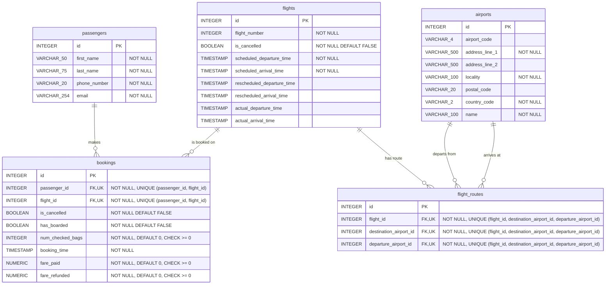
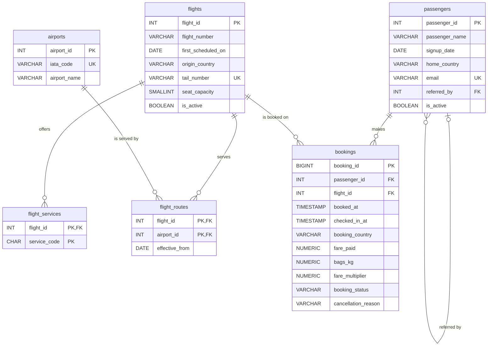

# ex603-airline-bookings-database

## Name
Shane Nycum

## Summary
Flight booking system for an airline to manage customer bookings

## Domain
This system is a PostgreSQL database for manageing flight bookings for an airline. The system is designed for a single airline - NOT an airport servicing multiple airlines.

It allows customers or airline staff to book flights and query information related to the customer bookings and flight statuses. It can answer questions related to:

1. Passenger booking (i.e. which customers have booked a given flight?)

2. Flight schedule adherence (i.e. what is the time difference between the scheduled arrival time and actual arrival time?)

3. Revenue (i.e. how much revenue did a given flight generate?)

4. Flight routes (i.e. which airports have the most flight activity?)

## Part 1: Units 1-2 - My database design

This part is my own design for the airline booking system, from Units 1 and 2. The DDL is in [schema.sql](schema/schema.sql). The queries in Part 2 do not run against this design. They run against the course dataset described in Part 2.

### Entity Relationship Diagram


### Schema

- **`passengers`** - One row per customer. Independent entity; referenced by `bookings`.
- **`flights`** - One row per flight. Tracks scheduled, rescheduled, and actual departure/arrival times. Independent entity; referenced by `bookings` and `flight_routes`.
- **`airports`** - One row per airport, with location and indentifying information (such as airport code). Independent entity; referenced twice by `flight_routes` (once as departure, once as destination).
- **`bookings`** - Junction table resolving the many-to-many relationship between `passengers` and `flights`, plus booking-specific facts (cancellation, boarding, bag count, fare paid/refunded).
- **`flight_routes`** - Junction table resolving the many-to-many relationship between `flights` and `airports`, recording each flight's departure and destination airport.

#### Design decisions:

- **Surrogate keys.** All five tables use surrogate primary keys. `passengers`, `flights`, and `airports` need them because their natural key candidates (names, flight numbers, airport codes) are either mutable or not guaranteed unique. `bookings` and `flight_routes` would be good candidates to use a natural key for the sake of this project, since they are not referenced by any other tables. However, I opted to use a surrogate primary key in order to try and replicate the best decision for a real-life system. In the real world, these tables would be likely to be referenced or queried in many different places.
- **`ON DELETE NO ACTION`** everywhere. Every foreign key in the schema uses `NO ACTION` rather than `CASCADE`. `bookings` and `flight_routes` rows are historical/financial records that must not disappear just because a passenger, flight, or airport row is later deleted. 
- **`NUMERIC(10,2)` for money.** `fare_paid` and `fare_refunded` use `NUMERIC` rather than floating point, to avoid rounding errors accumulating across financial calculations.
- **CHECK constraints on non-negative values.** `num_checked_bags`, `fare_paid`, and `fare_refunded` all have `CHECK (... >= 0)` constraints, since negative values in any of these columns describe no real-world state.

## Part 2: Units 3-6 - Analysis of the course dataset

From Unit 3 on, all queries run against the course reference dataset in the database `ex603_data`. It has the same theme as my design (airline bookings), but the tables and columns are different. The tables are created and filled by the DDL file provided in Unit 3 (`airline.sql`, not stored in this repository).

### Database Overview



### Query Catalogue

#### Unit 3: Filtering and query forms

| Query | File | Business question |
|-------|------|-------------------|
| 3.1.1 to 3.1.5 | [q3_1.sql](queries/unit3/q3_1.sql) | What does the data contain? (active flights with large capacity, the possible booking statuses, fares between $20 and $30, cancelled or disputed bookings, flight numbers starting with VN20, bookings with no cancellation reason, and a size label for each flight) |
| 3.2.A.1 to 3.2.A.5 | [q3_2.sql](queries/unit3/q3_2.sql) | Why does the dashboard query show only 27 bookings without a cancelled flight, and what is the fix (193 bookings)? |
| 3.2.B.1 to 3.2.B.3 | [q3_2.sql](queries/unit3/q3_2.sql) | Which bookings have an adjusted fare (fare paid times multiplier) over 40, and why does an alias fail in WHERE? |
| 3.3.1 to 3.3.5 | [q3_3.sql](queries/unit3/q3_3.sql) | Which passengers were involved in disputed bookings (IN, CTE and CASE forms), and do the three forms always match? |

#### Unit 4: Aggregations and analysis

| Query | File | Business question |
|-------|------|-------------------|
| 4.1.1 | [q4_1.sql](queries/unit4/q4_1.sql) | What do bookings look like overall (count, total, average, lowest and highest fare, number of passengers, and how many have a $0 fare)? |
| 4.1.2 | [q4_1.sql](queries/unit4/q4_1.sql) | How many bookings does each flight have, and what is its average fare? |
| 4.1.3 | [q4_1.sql](queries/unit4/q4_1.sql) | Which flights have at least 10 bookings, so their numbers mean something? |
| 4.1.4 | [q4_1.sql](queries/unit4/q4_1.sql) | How do fares vary by region (booking country) and booking status together? |
| 4.2.A | [q4_2.sql](queries/unit4/q4_2.sql) | For each flight, how many bookings are there, how many were cancelled, and what is the cancellation rate? |
| 4.2.B | [q4_2.sql](queries/unit4/q4_2.sql) | What are the total bookings, cancelled bookings, cancellation rate and total fare for each region, plus a grand total for the platform? |
| 4.2.C | [q4_2.sql](queries/unit4/q4_2.sql) | What is the cancellation rate for the busiest flights (15 or more bookings)? |

#### Unit 5: Joins and query patterns

| Query | File | Business question |
|-------|------|-------------------|
| 5.1.1 | [q5_1.sql](queries/unit5/q5_1.sql) | Who are the passengers behind each booking, and which flight was each booking for? |
| 5.1.2 | [q5_1.sql](queries/unit5/q5_1.sql) | Which airports are linked to the flagged flights (2, 9 and 11) through `flight_routes`, and do they share any? |
| 5.1.3 | [q5_1.sql](queries/unit5/q5_1.sql) | How do the flagged flights compare with other flights from the same origin country? |
| 5.2.A | [q5_2.sql](queries/unit5/q5_2.sql) | Which flights does an INNER JOIN leave out compared to a LEFT JOIN, and how many? |
| 5.2.B | [q5_2.sql](queries/unit5/q5_2.sql) | Do LEFT JOIN and RIGHT JOIN match, and what does a FULL OUTER JOIN show? |
| 5.2.C | [q5_2.sql](queries/unit5/q5_2.sql) | Which flights have never had a booking (NOT EXISTS vs EXCEPT)? |
| 5.3.A | [q5_3.sql](queries/unit5/q5_3.sql) | Does a CROSS JOIN of airports and flights return 5 x 15 = 75 rows? |
| 5.3.B | [q5_3.sql](queries/unit5/q5_3.sql) | How does PostgreSQL plan and run the three-table join from 5.1.1? |

#### Unit 6: Window functions and analytics

| Query | File | Business question |
|-------|------|-------------------|
| 6.1.1.1 | [q6_1.sql](queries/unit6/q6_1.sql) | Is a booking unusual for its own flight? (each booking next to its flight's average fare, using a window function) |
| 6.1.1.2 | [q6_1.sql](queries/unit6/q6_1.sql) | What does the same average look like with GROUP BY, and what is lost? |
| 6.1.2 | [q6_1.sql](queries/unit6/q6_1.sql) | How do flights rank by number of non-cancelled bookings with ROW_NUMBER, RANK and DENSE_RANK, and how do they treat ties? |
| 6.1.3 | [q6_1.sql](queries/unit6/q6_1.sql) | Which of four bands (NTILE) does each flight fall in, based on non-cancelled bookings, and what happens to tied flights at a band boundary? |
| 6.2.A | [q6_2.sql](queries/unit6/q6_2.sql) | Is the fare on flight 6 going up or down from one booking to the next (LAG, LEAD and delta)? |
| 6.2.B | [q6_2.sql](queries/unit6/q6_2.sql) | How close is Q4 2023 fare to a $1,000 target (running total), and what is the recent daily average (moving average)? |
| 6.2.C | [q6_2.sql](queries/unit6/q6_2.sql) | Which flights went more than 60 days between two bookings? |
| 6.3.A | [q6_3.sql](queries/unit6/q6_3.sql) | What are the three highest fares on each flight, and how far below the flight's highest fare is each one? |
| 6.3.B.1 | [q6_3.sql](queries/unit6/q6_3.sql) | Is the cancellation rate getting better or worse each month, and is any month missing? |
| 6.3.B.2 | [q6_3.sql](queries/unit6/q6_3.sql) | What is the cancellation rate for each quarter, and how does it change from the prior quarter? (used for the closing memo) |

Write-ups: [unit6.md](analysis/unit6.md) (Tasks 6.1 to 6.3 and reflection) and [unit6-finding.md](analysis/unit6-finding.md) (closing memo).

### Technical Highlights

- **Conditional aggregation** (Unit 4, [q4_2.sql](queries/unit4/q4_2.sql)). `SUM(CASE WHEN booking_status = 'cancelled' ...)` counts all bookings and cancelled bookings in the same query. It gives the cancellation rate for each flight and region without running the query twice.
- **LEFT JOIN to keep unmatched rows** (Unit 5, [q5_2.sql](queries/unit5/q5_2.sql)). An INNER JOIN hides flights 14 and 15 because they have no bookings. The LEFT JOIN keeps them, so counts such as bookings per flight cover all 15 flights.
- **Ranking functions** (Unit 6, [q6_1.sql](queries/unit6/q6_1.sql)). ROW_NUMBER, RANK and DENSE_RANK side by side show how each one treats flights tied at 15 bookings. This matters when a ranking is published.
- **LAG in a CTE** (Unit 6, [q6_2.sql](queries/unit6/q6_2.sql)). LAG finds the days between a flight's bookings. The filter for long gaps goes in the outer query, because WHERE cannot use a window function result in the same query.
- **Month-over-month with LAG and NULLIF** (Unit 6, [q6_3.sql](queries/unit6/q6_3.sql)). Each month's cancellation rate is compared with the previous month's. NULLIF avoids dividing by zero when a month has no cancellations. A missing-month check makes sure LAG is comparing the right months.

### Findings and Recommendations

The full memo is in [unit6-finding.md](analysis/unit6-finding.md).

1. **The cancellation rate was higher at the start of 2023 and has been flat since.** The cancellation rate is the share of bookings that were cancelled. It was 22.6% in Q1 and about 15% in each quarter after that (q6_3.sql, 6.3.B.2). Monthly counts are too small to show a trend. *Recommendation:* track the cancellation rate every month and review the cancellations when it rises two months in a row. It rose in both November and December (q6_3.sql, 6.3.B.1).
2. **Flights 2, 9 and 11 cancel much more than the rest.** Their cancellation rates are 25.0%, 28.6% and 31.3%, compared with 17.0% for the whole platform (q4_2.sql, 4.2.A and 4.2.B grand total). *Recommendation:* review the cancellations on these three flights with the operations team.
3. **Flights 14 and 15 have never had a booking** (q5_2.sql, 5.2.C.1). *Recommendation:* find out whether they are new, set up by mistake, or hard for customers to find.

### Limitations and Future Improvements

The bookings table only has data from one year (2023), and monthly counts are only 11 to 21 bookings. One or two cancellations change a monthly rate a lot, and there is no earlier year to compare Q1 2023 with. This makes it hard to say whether the cancellation rate is really improving. Another year of bookings would show whether the high first quarter is a pattern or a one-off.

## Video Presentation

Video link: [video-presentation.mp4](video/video-presentation.mp4)

## How to Run It

This repository uses two different databases. The commands below use `psql`, so you need PostgreSQL installed and the `psql` command available. Run all commands from the root folder of this repository. If you prefer, you can instead connect to the database with a tool like pgAdmin or DataGrip, then open the `.sql` files and run them there.

### Database 1: My own design (Units 1-2)

This is the schema I designed in Unit 2. None of the query files in this repository run against it. They all run against the course dataset.

```
createdb ex603_airline_bookings
psql -d ex603_airline_bookings -f schema/schema.sql
```

### Database 2: The course dataset (Units 3-6)

All the queries in `queries/` run against this database. Its tables and columns are different from Database 1. The data comes from the `airline.sql` file provided with Assignment 3. That file is not stored in this repository, so download it first and put it in the repository's root folder.

1. Create the database and load the data:

   ```
   createdb ex603_data
   psql -d ex603_data -f airline.sql
   ```

2. Run a query file. This runs every query in the file and shows each result:

   ```
   psql -d ex603_data -f queries/unit6/q6_1.sql
   ```
